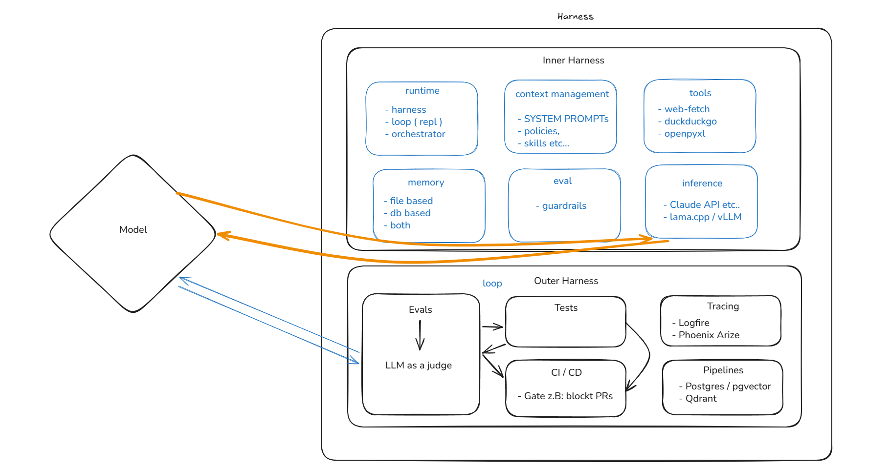

# Daedalus Agent

[](https://www.python.org/downloads/)
[](https://docs.astral.sh/uv/)
[](https://ai.pydantic.dev/)
[](LICENSE)

Autonomous agent framework built on [Pydantic AI](https://ai.pydantic.dev/) 2.0 beta. Daedalus evaluates and refines its own execution strategies over time combining type safe structured generation with a harness oriented architecture so tasks improve with each run, not only on the first attempt.

## Overview

In Greek mythology, Daedalus was a master craftsman and inventor who built complex systems and pushed the limits of his own designs. This project applies that idea to agentic workflows: strict schemas, observable runs, and iterative refinement instead of one-shot prompts.

## Architecture

<p align="center">
  <a href="https://excalidraw.com/#json=FrnXj32-3xJTRiuZkCSL7,mNXcZ_aoDaeU_ZOBnjHFYw">
    
  </a>
</p>

<p align="center">
  <a href="https://excalidraw.com/#json=FrnXj32-3xJTRiuZkCSL7,mNXcZ_aoDaeU_ZOBnjHFYw"><strong>Open diagram in Excalidraw</strong></a>
  · edit live, then export to refresh the preview below
</p>

The diagram shows the **Model** at the center, with **runtime** (harness, REPL loop, orchestrator) and **memory** (file-, DB-, or hybrid-backed) on one side, and an **Evals** loop (LLM-as-judge) feeding back into the model.

To update the image in the repo: in [Excalidraw](https://excalidraw.com/#json=FrnXj32-3xJTRiuZkCSL7,mNXcZ_aoDaeU_ZOBnjHFYw), choose **Export image → Embed scene**, save as `docs/architecture.excalidraw.png`, and point the `` `src` at that file so the PNG stays editable in Excalidraw ([embedded scene](https://kevinjalbert.com/using-excalidraws-embedded-scene-feature-for-collaborative-diagramming/)).

## Features

- **Pydantic AI 2** — Structured outputs, tool use, and provider integrations via `pydantic-ai-slim`
- **Multi-provider** — Anthropic and Hugging Face (extensible through optional extras)
- **Web tools** — HTTP fetch and DuckDuckGo search for grounded, up-to-date context
- **uv-native** — Reproducible installs from `pyproject.toml` and `uv.lock`

## Requirements

- Python **3.14+**
- [uv](https://docs.astral.sh/uv/getting-started/installation/)

## Installation

```bash
git clone https://github.com/<owner>/daedalus-agent.git
cd daedalus-agent
uv sync --prerelease=allow
```

## Usage

```bash
uv run daedalus-agent
```

## Configuration

Create a `.env` file in the project root for provider credentials (for example `ANTHROPIC_API_KEY`, `HF_TOKEN`). See [Pydantic AI model configuration](https://ai.pydantic.dev/models/) for provider-specific variables.

```bash
cp .env.example .env   # when .env.example is available
# edit .env with your keys
```

## Development

```bash
uv sync --prerelease=allow
uv run daedalus-agent
```

CI is defined under [`.github/workflows/ci.yml`](.github/workflows/ci.yml). After pushing to GitHub, add a workflow badge by replacing `<owner>` and `<repo>`:

```markdown
[](https://github.com/<owner>/<repo>/actions/workflows/ci.yml)
```

## License

No license file is included yet. Add a `LICENSE` and update the badge above when you choose one.
